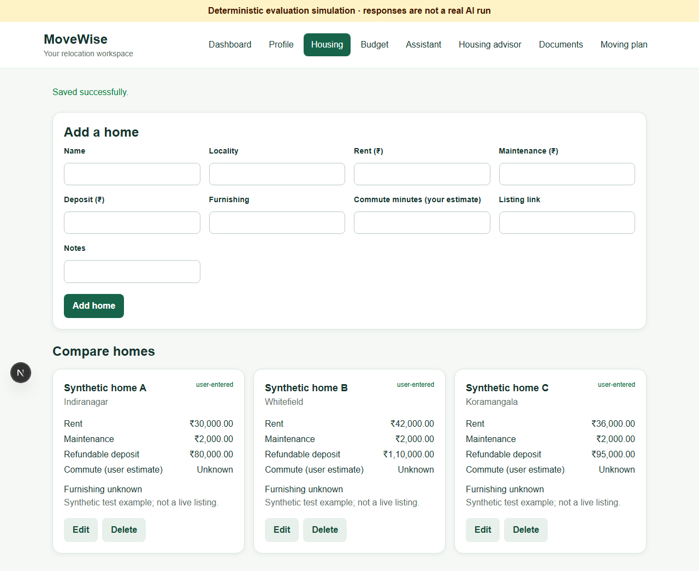
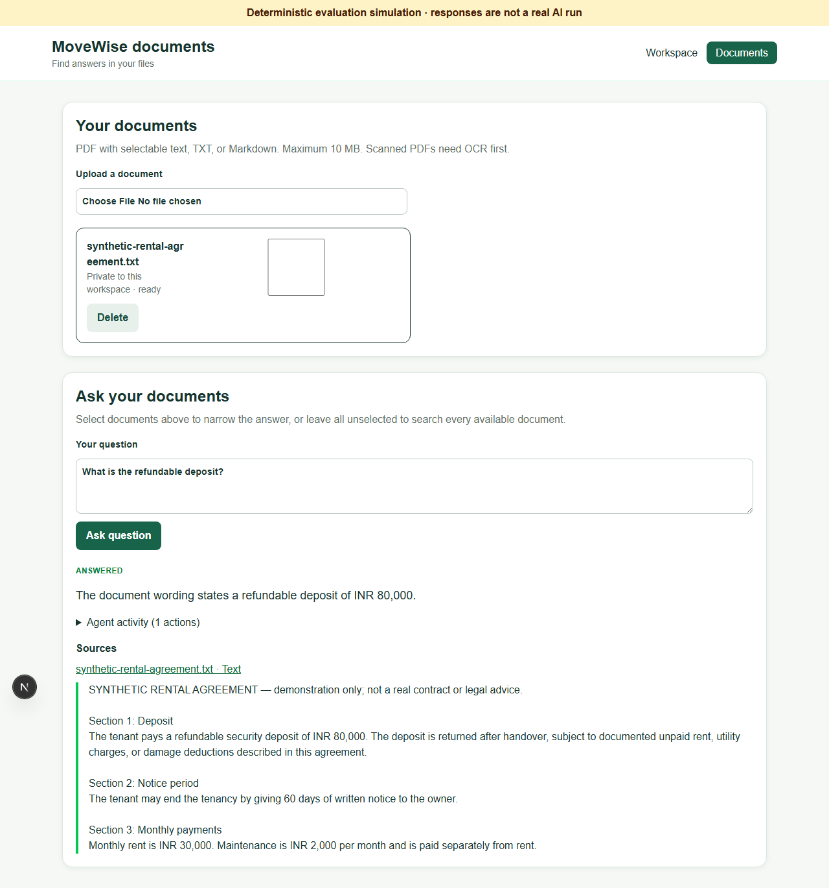
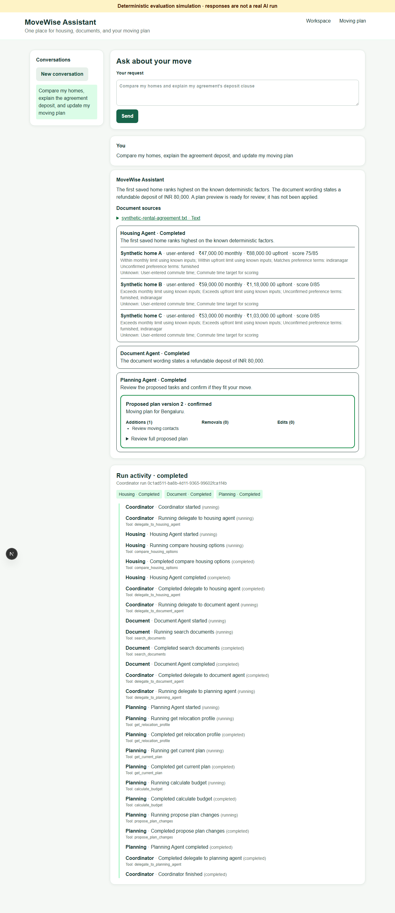

# MoveWise

MoveWise is a full-stack relocation workspace for a profile, saved homes, cost estimates, private documents, cited answers, and a versioned moving checklist. Four bounded agents use LangGraph and LangChain tools for housing, document questions, planning, and combined requests. The browser never receives provider credentials.

These screenshots came from the **deterministic mock browser test** with synthetic homes and an agreement. They do not show a real model run, live listings, or real rents.

## What the components do

| Component | Example in MoveWise |
| --- | --- |
| GenAI | The Planning Agent requests structured dated tasks and the specialists explain their findings. |
| RAG | The Document Agent retrieves agreement chunks and cites the clause for the refundable ₹80,000 deposit. |
| Specialist agents | Housing selects saved-data and calculator tools; Document searches and may refine evidence; Planning reads context and proposes tasks. |
| Coordinator | A combined request delegates to Housing, Document, and Planning, then combines their structured findings and citations. |
| Deterministic services | Decimal arithmetic calculates monthly costs, deposits, upfront costs, feasibility, and housing score factors. |
| User control | Agent plan changes remain pending until a user reviews the exact diff and selects **Confirm changes**. |

See [architecture](docs/architecture.md) for the diagram, agent tool lists, ownership boundaries, and worker behavior. The [specification](docs/specification.md) records the scoring formula and plan rules.

## Local setup on Windows PowerShell

Requirements: Python 3.13, Node 24 with npm, PostgreSQL 17 or 18 with pgvector. Docker Desktop is optional; any local PostgreSQL with pgvector works. Pinned backend dependencies are in `backend/requirements.txt`, including LangChain 1.4.3 and LangGraph 1.2.11; the frontend lockfile pins Next.js 16.3.8 and Playwright 1.58.2. OpenAI is the default chat and embedding provider; Ollama is available for local development.

For local AI without OpenAI billing, install Ollama chat and embedding models, verify them with `ollama list`, and set `LLM_PROVIDER=ollama`, `LLM_MODEL=<your tool-capable chat model>`, `EMBEDDING_PROVIDER=ollama`, `EMBEDDING_MODEL=<your embedding model>`, and `OLLAMA_BASE_URL=http://localhost:11434` in `backend/.env`. Use a chat model that supports tool calling and JSON responses. The embedding model can be separate. Restart the API and workers after changing `.env`, then retry or reprocess documents so all stored vectors use the same embedding model. Ollama runs on your computer; no OpenAI key is needed in this mode. Local model speed and answer quality depend on the installed models. Ollama support is for this local development setup; production still requires the established auth and provider configuration described below.

1. Start the database with `docker compose up -d db`, or create a PostgreSQL database with pgvector and set `DATABASE_URL` in `backend/.env`.
2. In `backend`: `py -m venv .venv`; `.\.venv\Scripts\python -m pip install -r requirements.txt`; `Copy-Item .env.example .env`; edit `DATABASE_URL` and configure either OpenAI credentials or local Ollama model names; `.\.venv\Scripts\python -m alembic upgrade head`; `.\.venv\Scripts\python -m uvicorn app.main:app --reload`.
3. In two more `backend` terminals run `.\.venv\Scripts\python -m app.services.document_worker` and `.\.venv\Scripts\python -m app.services.assistant_worker`. Workers handle persisted ingestion and queued assistant runs; leave them running.
4. In `frontend`: `Copy-Item .env.example .env.local`; `npm ci`; `npm run dev`. Open `http://localhost:3000`. Liveness is `/api/v1/health`; database readiness is `/api/v1/ready` at `http://localhost:8000`.

Do not place API keys in the frontend or commit `.env` files. `OPENAI_API_KEY` is required only when OpenAI is the configured provider. Without a configured chat and embedding provider, profile, housing, budget, and document upload management still work, but embeddings and AI answers cannot complete. Files with no selectable PDF text require external OCR before upload. Keep one embedding model for a set of ingested documents; changing it requires reingestion even if its vector size matches.

To try a fully isolated **scripted** journey without PostgreSQL or credentials, run `cd frontend; npx playwright install chromium; npm run test:e2e`. Playwright starts a temporary SQLite API, mock providers, and Next.js, and writes screenshots to `docs/screenshots`. This checks plumbing and user flow; it is not a real provider or pgvector test. The normal app never silently substitutes mock answers. [Demo script](docs/demo-script.md) gives a five-minute walkthrough, and [evaluation](docs/evaluation.md) reports actual mock metrics and limits.

## Features and use

Create a profile with destination, move date, household size, preferences, and spending limits. Add saved homes with your own amounts, source labels, notes, optional link and entered commute minutes. Use the budget page for monthly and upfront components. Unknown inputs remain unknown; a refundable deposit is kept separate from monthly spend. The three Bengaluru example homes and agreement in `data/demo` are synthetic. The browser test enters these examples visibly; they are not live listings.

Upload text PDF, UTF-8 TXT, or Markdown on Documents, wait for Ready, then ask a question. Click citations to inspect exact excerpts and page or section labels. Failed ingestion can be retried; deleting a private document removes the private file, chunks, and vectors. A shared synthetic guide, if seeded with `python scripts/seed_shared_guide.py`, is separately labeled. Uploads live in `backend/private_uploads` by default, outside public frontend assets.

The Housing advisor shows deterministic affordability and scoring, strengths, tradeoffs, and missing inputs. The Planning Agent generates a preview; confirmation creates an immutable version. Cancellation leaves the confirmed plan unchanged. Task completion survives appropriate revisions. LangGraph runs each specialist and the Coordinator through a model/tool state graph; LangChain structured tools execute only each agent's allowed workspace-bound handlers. The unified Assistant records conversation and parent/child run history, shows SSE tool activity, citations, and plan proposals. Reconnecting reads events and does not resubmit work. A **Cancel run** action prevents later steps, although an in-flight provider call may finish first.

## Checks and deployment preparation

Run `python -m pytest -q` in `backend`, and `npm run typecheck`, `npm run build`, `npm run test:e2e` in `frontend`. The current measured results are in [progress](docs/progress.md). A live PostgreSQL, pgvector, OIDC, or real provider run was not available in the development environment and remains to be checked before public use.

For public exposure, set `ENVIRONMENT=production`, `AUTH_MODE=oidc`, an established OIDC issuer/client, HTTPS frontend and API URLs, exact HTTPS CORS origins, a long random `SESSION_SECRET`, private absolute durable upload path, and secrets from a secret manager. Production settings reject development identity and mock providers. See `backend/.env.production.example` and `compose.prod.example.yaml`; these are templates, **not a deployment**. Set the database password consistently in Compose and `DATABASE_URL`, terminate TLS and enforce body limits at a trusted reverse proxy, provision backups for PostgreSQL and uploads, and run both workers. The API has in-process per-workspace request limits and a 10 MB file / 100 MB workspace upload quota by default; for multiple API replicas, use shared rate limiting at the proxy or a shared store. Private document text and secrets are excluded from agent event summaries. Do not publish until the real OIDC, PostgreSQL/pgvector, provider, backup, recovery, and proxy behavior have been validated in the target environment.

## Resume bullet drafts

- Built MoveWise, a Next.js and FastAPI relocation workspace with PostgreSQL models, versioned plans, workspace-scoped document retrieval, and explicit confirmation for agent-proposed changes.
- Implemented four bounded agents using LangGraph state graphs and LangChain structured tools, with deterministic Decimal cost calculations, cited document answers, and persisted SSE run history.
- Created a versioned synthetic evaluation and Playwright journey covering retrieval, routing, budget constraints, isolation, prompt injection, and plan confirmation; documented measured mock results and real-provider validation gaps.
