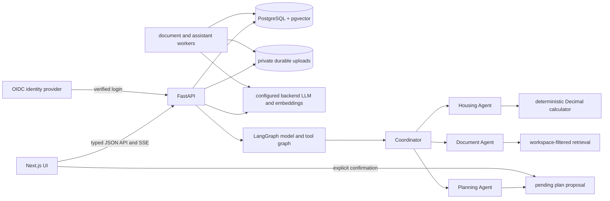

# Architecture

The frontend contains display code and a shared typed API client. Secrets, providers, retrieval, identity mapping, agent execution, budget arithmetic, and persistence run in the backend. Alembic owns schema changes. Every route, retrieval operation, and agent tool derives the workspace ID from the server session. Development uses an opaque cookie; production requires an OIDC verified issuer and subject mapped to a workspace. A signed, HTTP-only session holds the identity for eight hours. Production rejects mock providers, HTTP frontend origins, and relative private storage paths.

| Agent | Responsibilities | Allowed tools |
| --- | --- | --- |
| Housing | Compare saved homes; surface costs, preferences, and missing inputs | `get_relocation_profile`, `list_housing_options`, `calculate_budget`, `compare_housing_options` |
| Document | Search agreement evidence; answer with validated citations | `list_documents`, `search_documents`, `read_document_excerpt` |
| Planning | Build dated task proposals using profile, budget, home, and guides | `get_relocation_profile`, `get_current_plan`, `get_selected_home`, `calculate_budget`, `search_relocation_guides`, `propose_plan_changes` |
| Coordinator | Select specialists and combine structured results | `get_workspace_summary`, `delegate_to_housing_agent`, `delegate_to_document_agent`, `delegate_to_planning_agent` |

Each agent runs through a LangGraph `StateGraph`: a model node decides whether to answer or request tools, a tool node executes selected actions, and conditional edges repeat only when a tool call is present. LangChain `StructuredTool` wraps the allowed handlers with their JSON schemas. The Coordinator's delegation tools invoke the existing specialists; it still chooses which specialists to use through model output. Workspace IDs stay in server-bound closures, never tool arguments. The shared runtime bounds tool steps, elapsed time, and a conservative cumulative token estimate across parent and child graphs. Provider calls use remaining-time limits and one bounded transient retry. Coordinator delegations are sequential when later work depends on earlier findings. Specialists cannot call one another or the Coordinator. Agent events contain IDs, names, statuses, and short summaries; hidden reasoning, secrets, and document text are absent from event logs.

Document jobs and assistant runs are persisted in PostgreSQL. The document worker retries and recovers interrupted ingestion without duplicating chunks. The assistant worker claims queued runs; stale running work is marked failed rather than replayed. SSE reads saved events from an ID, so reconnecting never resubmits a mutation. Cancellation prevents later steps, though an in-flight provider call can finish before cancellation takes effect.

Uploads are stored outside frontend assets. Deleting a document removes its private file, chunks, and vectors. Production must mount persistent upload and database volumes, back them up, and apply retention policy. Plan proposals record exact additions, removals, and edits. Confirmation validates workspace ownership, source citations, base version, and context fingerprint; repeated confirmation returns the same version. Task completion is tracked by stable task ID across appropriate revisions. The assistant itself cannot confirm.

`/api/v1/health` is a process liveness check; `/api/v1/ready` checks database reachability. The example production Compose file is a deployment template, not a deployed service. A trusted reverse proxy must terminate TLS, enforce request body limits, and route the frontend and API. The in-process request limiter is per API process, so multi-replica production needs a shared rate limit store or proxy controls.
